# Pelicans on a bicycle

For more on this benchmark check out my talk [The last six months in LLMs, illustrated by pelicans on bicycles](https://simonwillison.net/2025/Jun/6/six-months-in-llms/) or review the [pelican-riding-a-bicycle tag](https://simonwillison.net/tags/pelican-riding-a-bicycle/) on my blog.

Prompt:

> `Generate an SVG of a pelican riding a bicycle`

## Running with smevals

This repository is now an [smevals](https://pypi.org/project/smevals/) Eval. The Task lives in `tasks/pelican.yaml`, the [llm](https://llm.datasette.io/)-based Runner is `run-llm`, and `graders/default.yaml` applies deterministic checks: the response must contain an SVG (extracted to `pelican.svg` by `checkers/extract-svg`, exactly as the old `generate-svgs.sh` did) and that SVG must be well-formed XML. Judging pelican-ness remains a job for human eyes - the web UI shows every extracted SVG as a Grade artifact.

```bash
smevals run . -m gpt-4o -m claude-3-haiku-20240307 -g   # new runs, graded on the fly
smevals grade .                                          # grade any ungraded runs
smevals report .                                         # markdown leaderboard
smevals serve .                                          # web UI on http://127.0.0.1:7001
```

Runs are recorded under `runs/pelican/default/<model>/<timestamp>/` and committed to the repository.

### Backfilled history

The 23 runs currently in `runs/` were backfilled from this repository's git history by `backfill-runs.py`: every committed revision of each `<model>.svg` (including the superseded first Claude 3 Haiku attempt) became one Run, timestamped with its commit date. Each backfilled `run.yaml` is marked `backfilled: true` and notes the caveats: `output.txt` holds the extracted SVG rather than the full model response, which was never committed, and failed attempts (the old `failures/` directory) were never committed so could not be recovered. `generate-svgs.sh` is kept for historical reference; `smevals run` replaces it.

The `<model>.svg` files below remain the originals in their traditional home in the repository root.

## Cerebras Llama models

### Cerebras Llama 3.1 70B
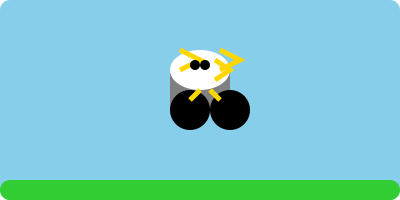

### Cerebras Llama 3.1 8B
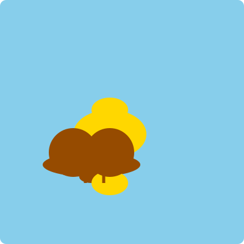

## Claude models

### Claude 3.5 Sonnet (2024-06-20)
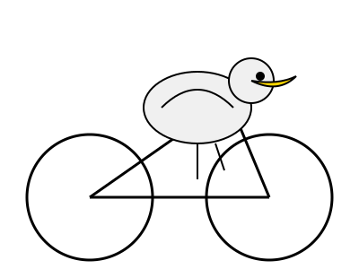

### Claude 3.5 Sonnet (2024-10-22)
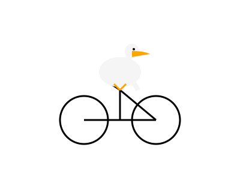

### Claude 3 Haiku


### Claude 3 Opus
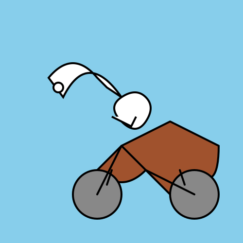

## Gemini models

### Gemini 1.5 Flash 001


### Gemini 1.5 Flash 002
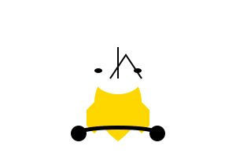

### Gemini 1.5 Flash 8B 001


### Gemini 1.5 Pro 001
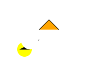

### Gemini 1.5 Pro 002
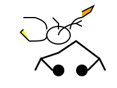

### gemini-exp-1114
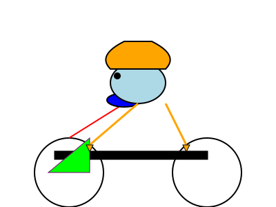

### gemini-exp-1121
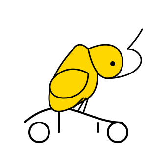

### gemini-exp-1206
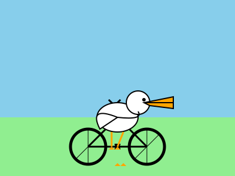

## OpenAI models

### GPT-3.5 Turbo


### GPT-4o mini
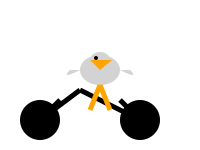

### GPT-4o
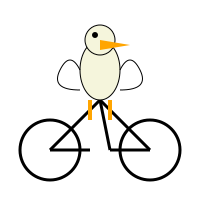

### o1-mini
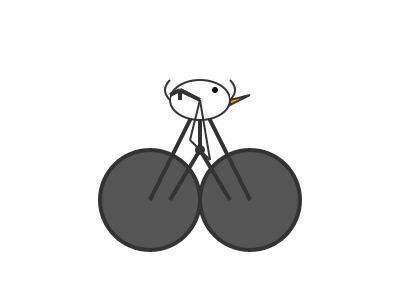

### o1-preview
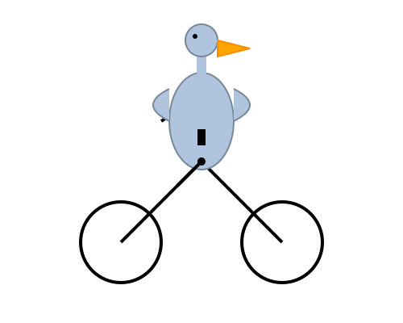

## AWS models

### Amazon Nova Micro
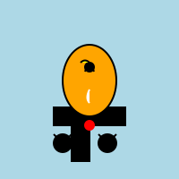

### Amazon Nova Lite
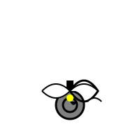

### Amazon Nova Pro
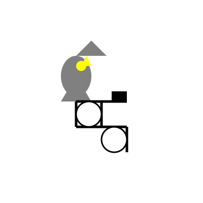
